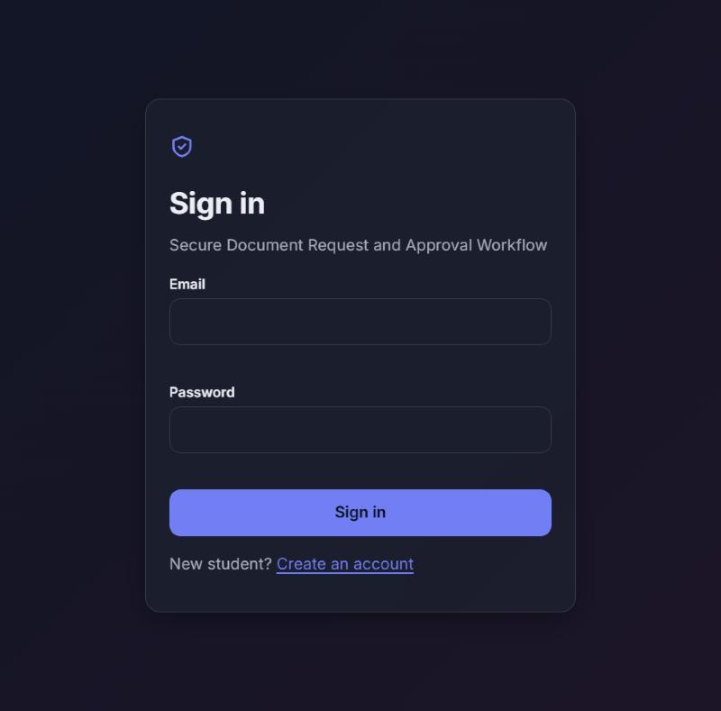
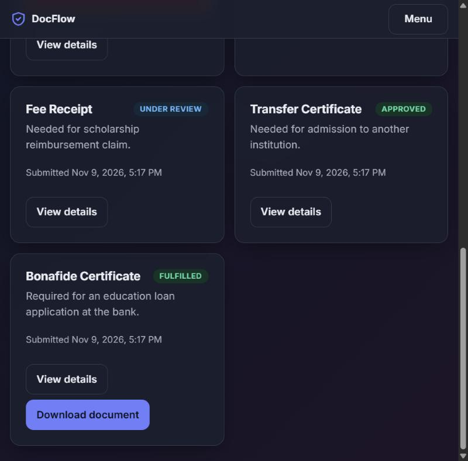
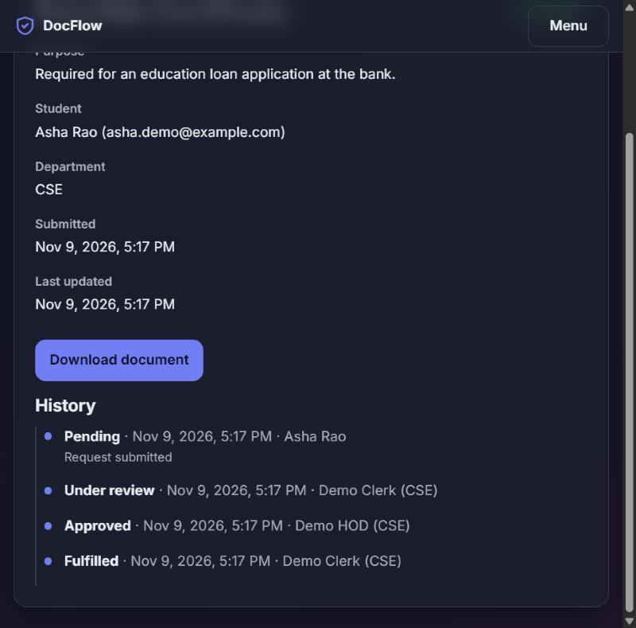
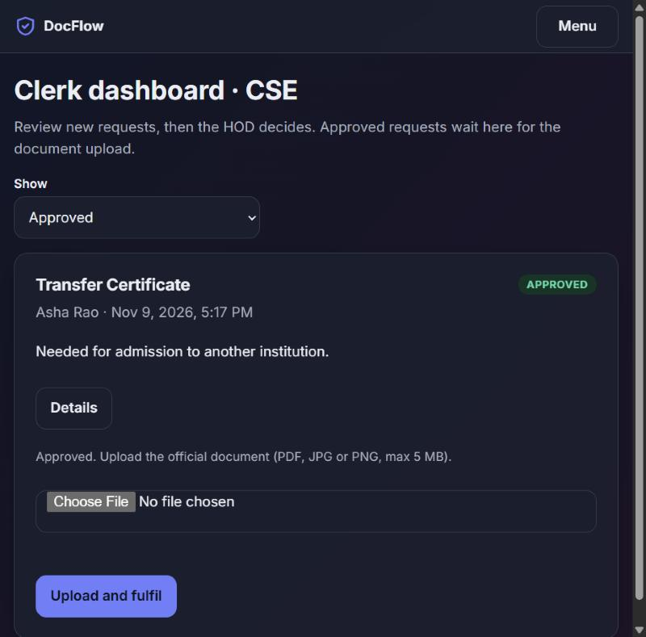
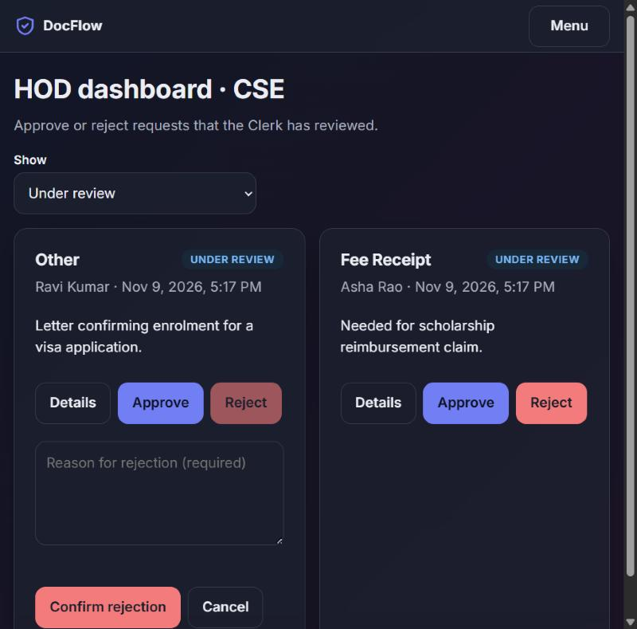
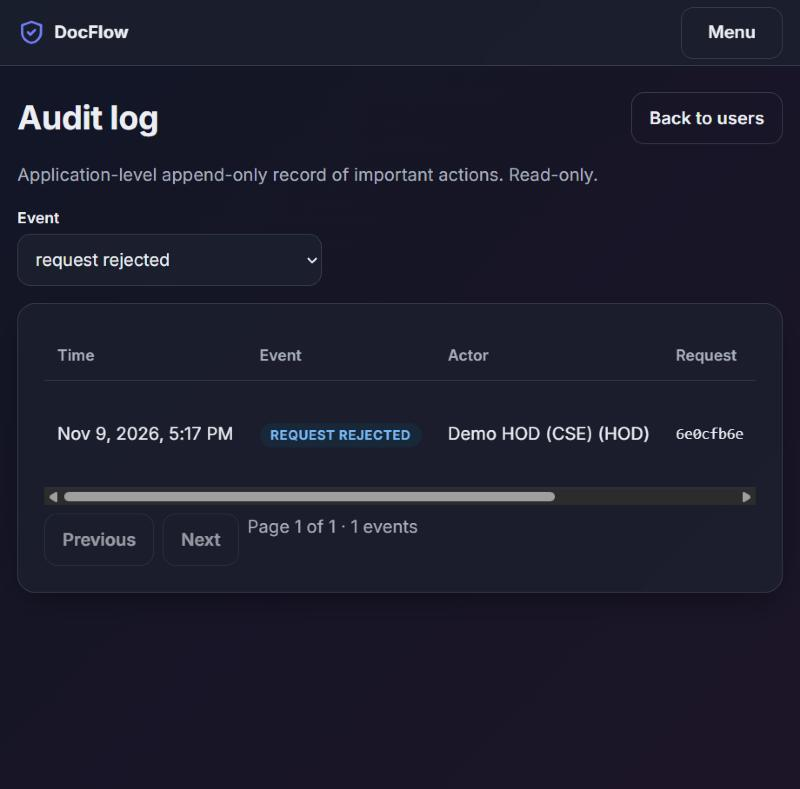

# Secure Document Request and Approval Workflow

**SDG 16: Peace, Justice and Strong Institutions** (targets 16.6 accountable institutions, 16.10 access to information)

Students request official institutional documents. A Clerk reviews the request, the Head of Department approves or rejects it (a rejection needs a reason), the Clerk uploads the official document, and the Student downloads it. Every important action is recorded in an audit log, and every rule is enforced on the server.

| | |
|---|---|
| **Status** | MVP (tag `mvp-v1.0`) plus SaaS phases S0-S3 on the `saas` branch; 341 automated tests pass. Prepared for MongoDB Atlas + Render ([docs/DEPLOYMENT.md](docs/DEPLOYMENT.md)) but **not deployed**. The Jenkins pipeline is written and its commands pass locally, but it has not run on a Jenkins server yet. |
| **Stack** | HTML/CSS/JavaScript, Node.js, Express, MongoDB (Mongoose), JWT in an HttpOnly cookie, bcryptjs, express-validator, Helmet, express-rate-limit, Multer, Jest, Supertest, Jenkins |
| **Roles** | Student, Clerk, HOD, Admin |

## Screenshots

| Sign in | Student dashboard | Request history |
|---|---|---|
|  |  |  |

| Clerk uploads document | HOD rejects with reason | Admin audit log |
|---|---|---|
|  |  |  |

More in [docs/screenshots](docs/screenshots/README.md), including the phone layout. All screenshots show demo data only.

## How it works

```
PENDING --Clerk reviews--> UNDER_REVIEW --HOD approves--> APPROVED --Clerk uploads--> FULFILLED
                                   \--HOD rejects (reason required)--> REJECTED
```

| Role | Can do |
|---|---|
| Student | Register, submit requests, see own requests, status history and rejection reasons, download the fulfilled document |
| Clerk | See own department's requests, move Pending to Under review, upload the document for Approved requests |
| HOD | See own department's requests, approve, or reject with a reason |
| Admin | Create Clerk/HOD accounts, activate or deactivate users, read the audit log. Cannot approve anything or read documents |

## Quick start

Requires Node.js 20+, npm and Docker.

```bash
docker compose up -d          # MongoDB single-node replica set, published on 127.0.0.1 only
cp .env.example .env          # then edit: JWT_SECRET, SIGNUP_KEY, (DEMO_PASSWORD)
npm install
docker exec sdw-mongo mongosh --eval "rs.initiate({_id:'rs0',members:[{_id:0,host:'localhost:27017'}]})"   # first run only
npm start                     # http://localhost:3000  -> open /signup.html to create an institution
```

Generate a secret: `node -e "console.log(require('crypto').randomBytes(48).toString('hex'))"`.
Each institution is created at `/signup.html` (needs `SIGNUP_KEY`) and is then served at `/t/<address>/`; its Admin invites staff from the Admin page (they choose their own passwords; see [docs/ACCOUNTS.md](docs/ACCOUNTS.md)). See [docs/TENANCY.md](docs/TENANCY.md) and, for departments, document types and the approval chain, [docs/WORKFLOW.md](docs/WORKFLOW.md). Existing single-tenant data: `npm run migrate:tenants`.

### Scripts

| Command | What it does |
|---|---|
| `npm start` / `npm run dev` | Run the server / run with auto-restart |
| `npm run seed:superadmin` | One-time platform owner (SUPER_ADMIN) from environment variables |
| `npm run migrate:tenants` | Move single-tenant MVP data into an institution (dry run unless `-- --apply`) |
| `npm run seed:demo` / `seed:demo:clean` | Create / remove demo accounts and requests in every status (needs `DEMO_PASSWORD`, refuses in production) |
| `npm test` | Full test suite (needs the MongoDB container) |
| `npm run test:unit` | Pure-logic tests only |
| `npm run test:ci` | Full suite with a JUnit report in `reports/` (used by Jenkins) |
| `npm run lint` | ESLint |
| `npm run build` | Build verification: files present and a real HTTP server answers correctly |
| `npm run check:atlas` | Tests your MongoDB Atlas connection (replica set + a read-only transaction) from `MONGODB_ATLAS_URI` in your local `.env`. Never prints the connection string. |

### Environment variables

See [.env.example](.env.example). Required: `JWT_SECRET` (32+ characters), `MONGODB_URI`. Local development and tests use the Docker MongoDB; **production uses MongoDB Atlas through `MONGODB_URI` set in the Render dashboard**. Tests use `MONGODB_URI_TEST` and refuse to run against anything but a local MongoDB (they drop their database). Nothing secret is committed; `.env` is git-ignored.

## Project layout

```
client/      static frontend (HTML, CSS tokens/components, ES modules), served by Express
server/      routes -> controllers -> services -> models, middleware, validators, tests
scripts/     seedSuperAdmin.js, migrateToTenants.js, seedDemo.js, verifyBuild.js, checkAtlas.js
docs/        SRS, API, UML, testing, transactions, CI, demo guide, limitations, screenshots
Jenkinsfile  CI pipeline            docker-compose*.yml  MongoDB for dev and CI
```

## Security highlights

- All authorisation is on the server: role checks plus ownership (Student) and department (Clerk, HOD) scope; out-of-scope resources return 404.
- Public registration can only create Students; staff join by invitation from the Admin of their institution; passwords are never chosen by anyone else.
- Every status change is one atomic conditional update, so two simultaneous actors cannot both succeed; it commits together with its audit record in a transaction.
- Uploads: PDF/JPG/PNG only, real signature checked, 5 MB cap, random file names, stored outside the web root, downloads only through an authorised endpoint.
- HttpOnly SameSite=Strict cookie, CSRF header, Helmet CSP, rate limits, NoSQL operator sanitising, strict validation, no `innerHTML`, deactivation takes effect immediately.
- The audit log is append-only at application level. It is **not** absolutely immutable.

## Documentation

| Document | Contents |
|---|---|
| [docs/SRS.md](docs/SRS.md) | Requirements, business rules, acceptance status with evidence |
| [docs/API.md](docs/API.md) | Every endpoint, rules, status codes |
| [docs/UML.md](docs/UML.md) | Use case, class (2), sequence, activity, state, component diagrams |
| [docs/TESTING.md](docs/TESTING.md) | Real test results and the security scenario mapping |
| [docs/TRANSACTIONS.md](docs/TRANSACTIONS.md) | What is atomic, what is not, and why |
| [docs/CI.md](docs/CI.md) | Jenkins pipeline and what was verified |
| [docs/DEPLOYMENT.md](docs/DEPLOYMENT.md) | MongoDB Atlas + Render: settings, environment variables, file-storage limits, checklist (not yet deployed) |
| [docs/DEMO.md](docs/DEMO.md) | Demonstration script and presentation outline |
| [docs/LIMITATIONS.md](docs/LIMITATIONS.md) | Honest limits and future enhancements |
| [docs/SPRINT_PLAN.md](docs/SPRINT_PLAN.md), [docs/BACKLOG.md](docs/BACKLOG.md) | Agile plan and backlog |
| [docs/FINAL_IMPLEMENTATION_BLUEPRINT.md](docs/FINAL_IMPLEMENTATION_BLUEPRINT.md) | The patched implementation plan |
| [AGENTS.md](AGENTS.md), [CLAUDE.md](CLAUDE.md) | Rules for the AI coding agents used on this project |

## Production (MongoDB Atlas + Render)

Prepared but **not deployed**. Render settings: Web Service, build `npm ci`, start `npm start`, health check `/healthz`. Required variables: `NODE_ENV=production`, `MONGODB_URI` (Atlas), `JWT_SECRET`, and `UPLOAD_DIR` on a persistent disk. In production the app binds `0.0.0.0` on Render's `PORT`, trusts one proxy hop, and refuses to start with a local or missing database URI. Uploaded documents live on the server filesystem, which is wiped on every deploy unless a paid persistent disk is mounted. Full checklist and limits: [docs/DEPLOYMENT.md](docs/DEPLOYMENT.md).

## Known limitations (short list)

No password change/reset, no notifications, no automated browser tests, Jenkins not yet run on a server, MongoDB must be a replica set for full atomicity, and uploaded files need a persistent disk (or object storage) in production. See [docs/LIMITATIONS.md](docs/LIMITATIONS.md).
