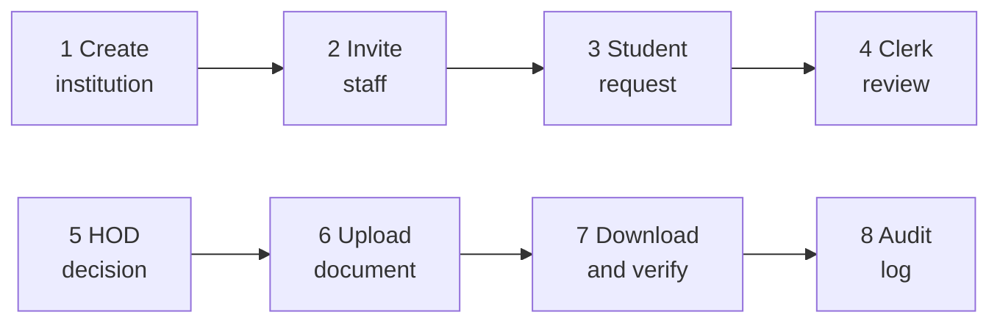

# DocFlow: Simple Demo of the Hosted Website (Render)

Start from an **empty site** and show the whole workflow in about **12 minutes**. Replace `<your-url>` with your Render address.

## The idea in one picture (steps 1 to 4, then 5 to 8)

## Before you start (5 minutes earlier)

- [ ] **Wake the site.** Open `https://<your-url>/healthz` and wait until it shows `{"status":"ok"}`. Free hosting sleeps; the first load can take up to a minute.
- [ ] **Have ready:** your **Signup key** (kept private), the file `docs/demo-assets/sample-bonafide-certificate.pdf`, and one easy password for all demo users (at least 8 characters, with a letter and a number, for example `Demo@1234`).
- [ ] **Four browser sessions** so everyone stays signed in at once: one normal and one incognito window in Chrome, and the same two in Edge (or another browser).
- [ ] **Pick four logins** (nothing is e-mailed; they are only usernames): `admin@demo.com`, `clerk@demo.com`, `hod@demo.com`, `student@demo.com`.

| Window | Person | Opens |
|---|---|---|
| 1 | Admin | `https://<your-url>/t/demo/login.html` |
| 2 | Clerk | via the invitation link |
| 3 | HOD | via the invitation link |
| 4 | Student | `https://<your-url>/t/demo/register.html` |

## The flow

### Step 1: Create the institution (2 min, Window 1)
1. Open `https://<your-url>/signup.html`.
2. Fill in: **Institution name** (for example "Demo Institute"), **Institution address** (`demo`), **Administrator name**, **Administrator email**, **Administrator password**, and the **Signup key**.
3. Press **Create institution**, then sign in at `https://<your-url>/t/demo/login.html`.

**Say:** "Each institution gets its own private space."

### Step 2: Admin invites a Clerk and an HOD (2 min, Window 1)
1. On **User management**, under **Invite staff**, enter the Clerk's email, role **Clerk**, department **CSE**. Press **Create invitation**.
2. A one-time link appears (e-mail is off in this demo). **Copy it and open it in Window 2.** Enter a name and password, press **Create my account**.
3. Repeat for the **HOD** (role **HOD**, department **CSE**) in Window 3.

**Say:** "The password is chosen by the person, never by the Admin."

### Step 3: Student registers and submits (2 min, Window 4)
1. On the register page, fill in the form with department **CSE** and register.
2. Under **Request a document**, choose **Bonafide Certificate**.
3. First type a very short purpose (like `test`) and submit: **the error shows the rules are checked.**
4. Type a proper purpose (at least 10 characters) and press **Submit request**. The request shows as **Pending**.

### Step 4: Clerk reviews (1 min, Window 2)
Open the **Pending** queue and press **Complete: Clerk review**.

**Say:** "The clerk only sees their own department."

### Step 5: HOD decides (1 min, Window 3)
1. Press **Reject**, leave the reason empty and try to confirm: **it refuses.** Cancel.
2. Press **Complete: HOD decision**. The request becomes **Approved**.

**Say:** "A rejection must always carry a reason the student can read."

### Step 6: Clerk issues the document (1 min, Window 2)
Choose the **Approved** filter, pick `sample-bonafide-certificate.pdf`, and press **Upload and fulfil**. The request becomes **Fulfilled**.

### Step 7: Student downloads and verifies (2 min, Window 4)
1. Refresh the page. Press **View details** to show the **history timeline** (who did what, and when).
2. Press **Download** and open the PDF.
3. Show the **verification link or QR**. Open it in a private window: the page says the document is **genuine**.

**Say:** "Anyone can confirm a document is real, even without an account."

### Step 8: Admin shows accountability (1 min, Window 1)
Open **View audit log**: every step above is listed with the person and the time.

## Closing line

> "Requests are tracked, every decision has a named person, access is limited by role and department, and anyone can verify the document."

## Two honest notes about the live site

- **Files do not survive a restart.** On the free plan, uploaded files disappear if the site restarts. Do steps 6 and 7 in one sitting.
- **It still shows the earlier design.** The new look is on a separate branch. The steps and button names above match the live site.

## If something goes wrong

| Problem | What to do |
|---|---|
| A page will not load | Wait a minute and refresh: the site may be waking up |
| Sign-in fails | Check the email and password you chose in step 1 |
| Signup says "closed" or "invalid key" | The Signup key in Render does not match what you typed |
| The Clerk's queue looks empty | The default view is **Pending**; use the status filter |
| Upload is refused | Use the sample PDF, not another file type, and keep it under 5 MB |
| Two windows keep logging each other out | Use four separate sessions (normal and incognito, in two browsers) |
