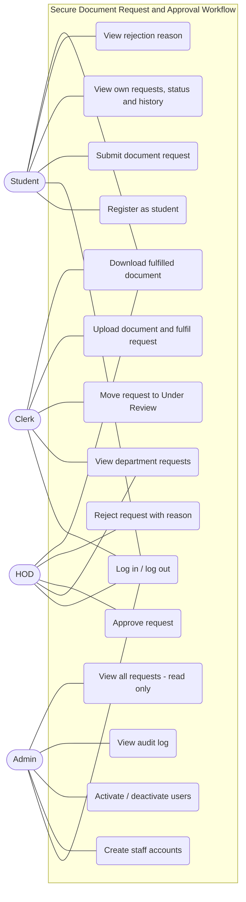
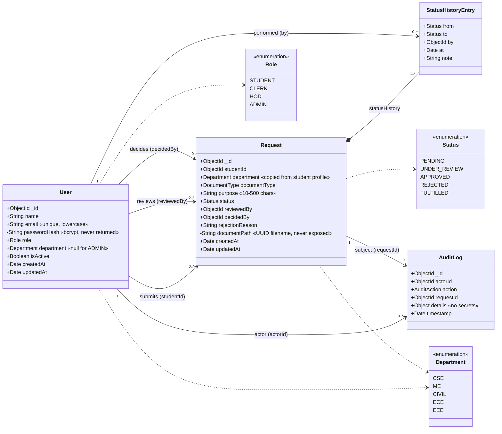
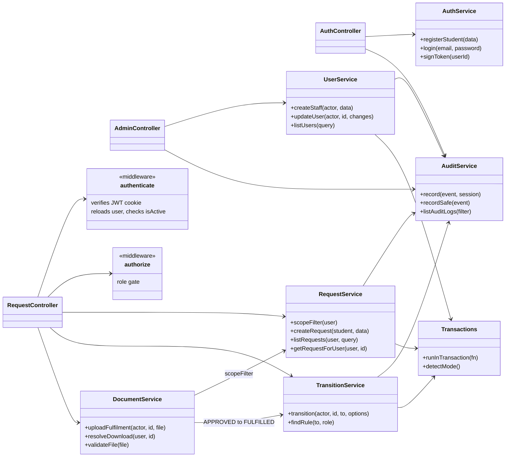
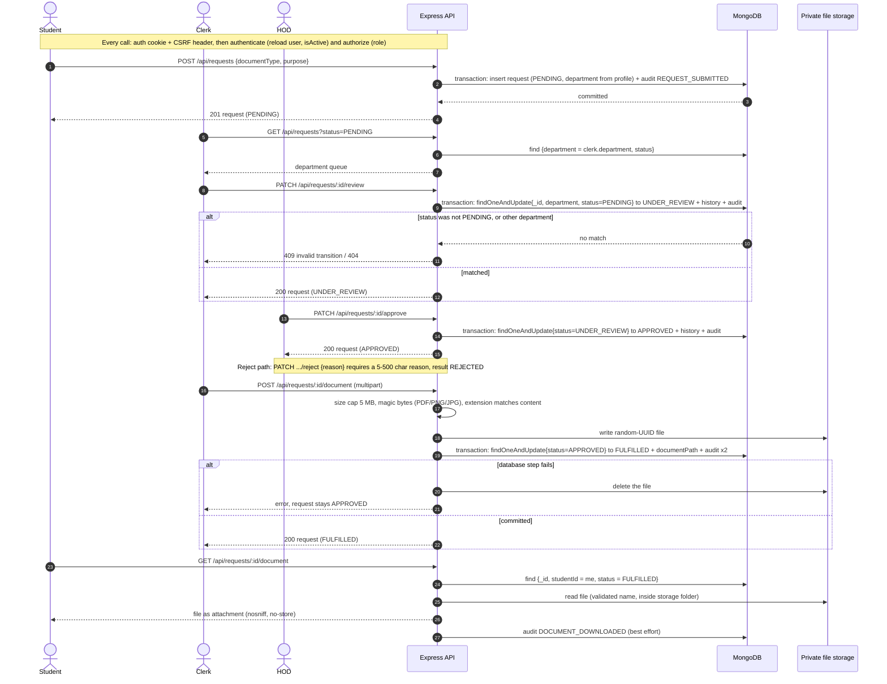
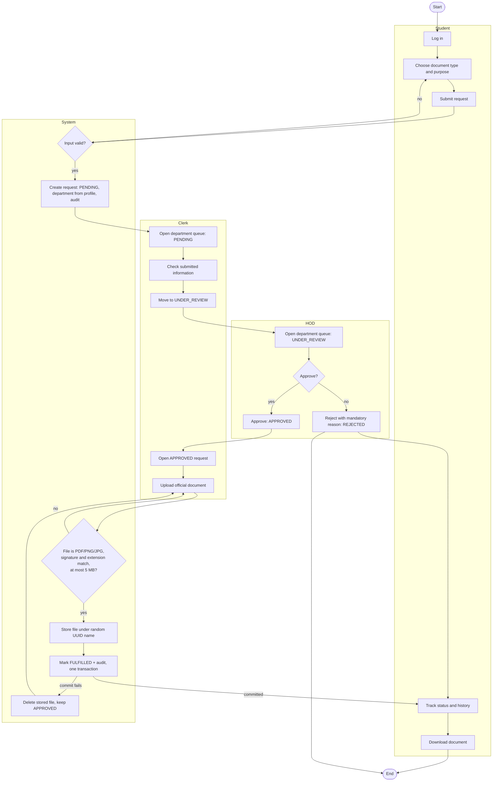
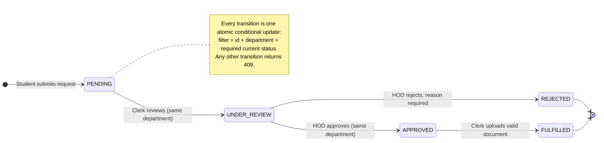
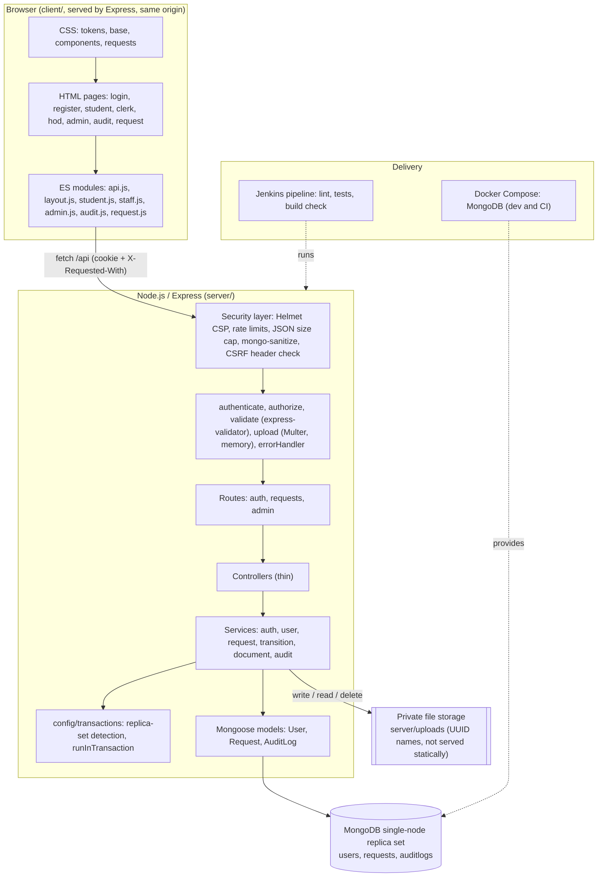

# UML Diagrams

These diagrams describe the implemented system (not a plan). They are written in [Mermaid](https://mermaid.js.org/), which GitHub, VS Code and most Markdown viewers render directly. The source of each diagram is in `docs/diagrams/*.mmd`; this page is generated from those files.

All seven diagrams were parsed successfully with Mermaid 10.9.1 (a deliberately broken diagram is rejected by the same checker). If the implementation changes, update the `.mmd` file and regenerate this page.

## 1. Use case diagram

Who can do what. Backend middleware enforces every one of these permissions; the buttons in the UI are only a convenience.

## 2. Class diagram (data model)

The three persisted collections (User, Request, AuditLog) and the embedded status history. Mongoose schemas live in `server/models/`. `passwordHash` and `documentPath` are never returned by the API.

## 3. Class diagram (service layer)

How controllers, middleware and services depend on each other. Business rules (scope, transitions, audit, transactions) live in `server/services/`, not in controllers.

## 4. Sequence diagram (request and approval process)

The complete lifecycle including the transaction boundaries, the file-then-database ordering, cleanup on failure, and the download check.

## 5. Activity diagram (submission to fulfilment)

Swim lanes for Student, Clerk, HOD and System, with the decision points (valid input, approve or reject, file checks, commit).

## 6. State diagram (request status)

The only five statuses and four permitted transitions (`TRANSITIONS` in `server/config/constants.js`). Anything else returns 409.

## 7. Component diagram

Frontend, backend layers, MongoDB, private file storage and the CI/CD pieces.

